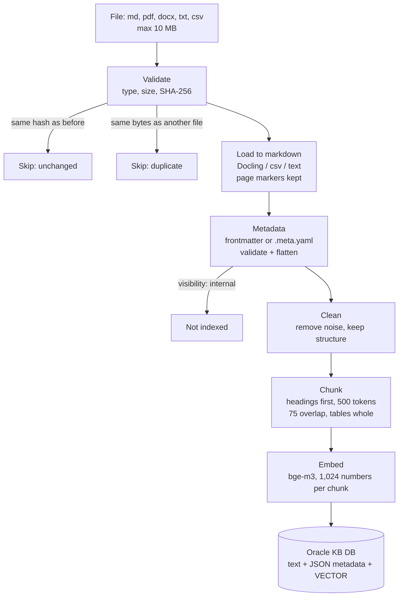
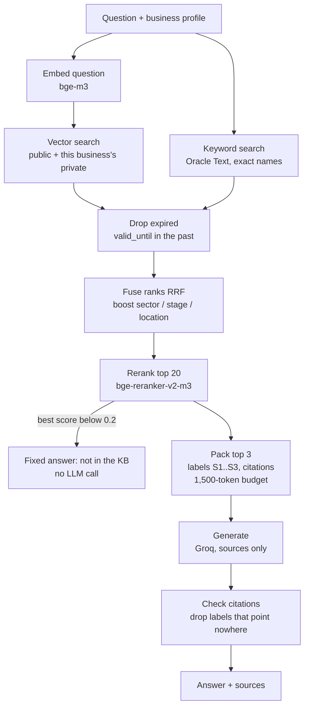

# RAG pipeline

How a file becomes searchable, and how a question becomes a cited answer.
Numbers are the defaults in `app/core/config.py`.

## Ingestion (write path)

| Step | Code | Rule |
| --- | --- | --- |
| Validate | `features/ingestion/service.py` | 10 MB max; hash of file + sidecar; unchanged files skipped; duplicates skipped |
| Load | `adapters/loaders/` | Markdown frontmatter, or `<file>.meta.yaml` for other types; type inferred from folder |
| Metadata | `features/ingestion/metadata.py` | `industry`/`stage`/`access` accepted as aliases; private needs `business_id`; market reports need publisher and year |
| Clean | `features/ingestion/cleaning.py` | Removes blank lines, extra spaces, broken lines, repeated headers/footers, page numbers, duplicate paragraphs, bad characters. Keeps headings, lists, tables, dates, currency |
| Chunk | `features/ingestion/chunking.py` | Small files stay one chunk; sentences packed to 500 tokens; ~75-token overlap; tables split by rows with header repeated; each chunk starts with its section path |
| Embed | `adapters/embedders/bge_m3.py` | Local model, no API cost; vectors normalised |
| Store | `adapters/vectorstores/oracle_store.py` | `MERGE` by chunk id; old chunks of a re-ingested file are deleted first |

Chunk id is `{source}#{index}`. Every chunk carries: title, type, visibility, business_id
(private only), sector, founder_stage, location, people, topics, date, publisher,
publication_year, valid_until, page_start, page_end, section, chunk_index, token_count,
content_sha256, source_sha256, embed_model.

**Storage maths.** Text about 2 KB (500 tokens) + vector 4 KB (1,024 x FLOAT32) + metadata
about 0.5 KB = about 6.5 KB per chunk. 6 GB holds about 900,000 chunks.

## Answering (read path)

| Step | Code | Rule |
| --- | --- | --- |
| Access | `features/retrieval/service.py` `access_filters` | Applied inside the store query, never left to the prompt |
| Fuse | `fuse` | Reciprocal rank fusion (k = 60), then x(1 + 0.15 per profile match) |
| Rerank | `adapters/rerankers/bge.py` | Scores mapped to 0..1; keep 3 with score >= 0.2 |
| Pack | `features/chat/packing.py` | Whole chunks only; best first; newer source wins near-ties |
| Fit | `features/chat/service.py` `_fit` | Whole call kept under 6,000 input tokens (Groq free plan) |
| Check | `check_citations` | Invalid labels removed; no valid citation = `low_confidence` |

## Testing retrieval

`python -m app.cli eval eval/questions.example.yaml` prints hit rate at 3 and MRR.
Replace the example with real founder questions written by Disha.

## Backups

`python -m app.cli backup` writes `data/backups/kb-<time>.jsonl.gz`. Copy it to Object
Storage in Account 4. `python -m app.cli restore <file>` loads it back.
